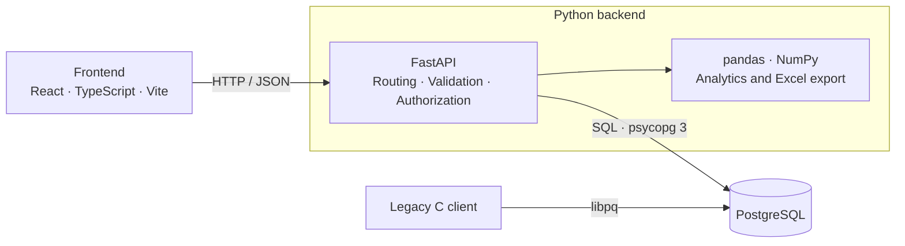

<!--
File overview
Purpose: Introduce EcoFleet and provide the repository's primary setup and feature reference.
Responsibilities: Describe current functionality, architecture, configuration, API usage, checks and roadmap.
Connections: Links backend/frontend setup to SQL migrations, source-code guides and the academic documentation.
-->
<div align="center">

# ⚡ EcoFleet Solutions

### Electric mobility, fleet management and data analytics.

A full-stack platform for managing shared electric vehicles,<br>
rentals, corporate customers and maintenance operations.

<p>
  
  
  
  
</p>
<p>
  
  
  
  
</p>

[Features](#features) · [Architecture](#architecture) · [Local setup](#local-setup) · [API](#api) · [Roadmap](#roadmap)

**Under development** · Working backend · React interface in progress

</div>

---

## About the project

**EcoFleet Solutions** explores the management of a shared electric mobility service: from finding a vehicle to completing a rental, from individual vehicle pricing to corporate agreements and fleet revenue analysis.

The project originated in the **Database Systems course at the University of Padua**, covering conceptual modeling, relational design, SQL and a C client. That foundation is now evolving into a web application with **React and TypeScript**, a **Python/FastAPI** backend and analytics built with **pandas and NumPy**.

It is also a practical learning project: connecting an interface to an API, handling data and transactions, building reports and, in future steps, creating a reproducible environment with **Docker** and exploring orchestration with **Kubernetes**.

## Features

| Area | Available functionality | Web interface |
| :--- | :--- | :--- |
| 🔐 Accounts | Individual and corporate registration, JWT login, profiles and role checks | Login and dashboard access |
| 🚗 Fleet | Vehicle lists and details, brand and status filters, individual vehicle pricing | Search and map planned |
| ⏱️ Rentals | Start, stop, personal history and checks on credit, battery and availability | Rental history display |
| 💳 Wallet | Virtual balance, top-ups and simulated payment method association | Wallet page planned |
| 🏢 Corporate | Company records, associated employees and contractual discount tiers | Dedicated dashboard planned |
| 🔧 Maintenance | Maintenance logging and vehicle status updates | Backoffice interface planned |
| 📊 Analytics | Total and per-vehicle revenue, average cost, standard deviation and Excel export | Analytics dashboard planned |

The PostgreSQL model covers electric cars, vans, scooters and bicycles, batteries, logistics hubs, stations and access points, customers, technicians, maintenance, rentals and receipts.

> The wallet uses **virtual credits**. Top-ups and payment methods are not connected to a real payment processor. Battery data comes from the database; there is no integration with telemetry devices.

## Architecture



- **Frontend:** handles navigation, authentication UI and the display of data returned by the API.
- **Backend:** validates requests with Pydantic, checks users and permissions, runs parameterized queries and coordinates transactions.
- **Database:** enforces constraints, relationships and business rules through functions and triggers, including cost calculation, mileage updates and receipt generation.
- **Analytics:** pandas structures and aggregates data; NumPy computes statistics; OpenPyXL generates `.xlsx` files in memory.

### Technology stack

| Component | Technologies | Purpose |
| :--- | :--- | :--- |
| User interface | React, TypeScript, React Router, Tailwind CSS | Components, navigation and styling |
| Frontend tooling | Vite, ESLint | Local server, builds and code checks |
| API | Python, FastAPI, Pydantic, Uvicorn | HTTP endpoints and validation |
| Persistence | PostgreSQL, PL/pgSQL, psycopg 3 | SQL queries, transactions, functions and triggers |
| Authentication | PyJWT, pwdlib, bcrypt | Access tokens and password hashing |
| Analytics and reporting | pandas, NumPy, OpenPyXL | Aggregation, statistics and Excel export |
| Backend testing | unittest, temporary PostgreSQL database | HTTP integration tests |
| Original client | C, libpq | Running queries from the academic project |
| Planned infrastructure | Docker, Kubernetes | Containerization and orchestration, not yet implemented |

## Pricing and rental rules

Pricing belongs to the **individual vehicle**: two cars in the same category can have different rates. PostgreSQL retrieves the hourly rate from the corresponding subtype table.

The current formula is:

```text
billable minutes = max(1, elapsed minutes rounded up)
final cost = round((€1 unlock fee + minutes × hourly rate / 60) × contract factor, 2)
```

| Contract | Discount on the total, including the unlock fee |
| :--- | ---: |
| Individual / Base | 0% |
| Silver | 5% |
| Gold | 10% |
| Premium | 15% |

**Example:** for a car priced at €120/hour, a 61-second rental is billed as two minutes. With a Premium contract: `(1 + 2 × 120 / 60) × 0.85 = €4.25`.

Starting a rental requires at least **€5 in credit**, a battery level of at least **15%**, an available vehicle and a compatible access point. A customer and a vehicle can each have only one active rental.

At the end of a rental, the cost, receipt, balance, mileage and vehicle status are updated in a single transaction. If credit is insufficient, the operation is rolled back and the rental remains active until the wallet is topped up. Row locks and unique indexes protect against concurrent requests and duplicate charges.

## Repository structure

```text
.
├── backend/
│   ├── app/
│   │   ├── main.py             # FastAPI application assembly
│   │   ├── api/
│   │   │   ├── dependencies.py # Authentication dependency
│   │   │   └── routes/         # Auth, fleet, rentals, corporate, backoffice
│   │   ├── core/              # Environment settings and security
│   │   ├── db/                # PostgreSQL connection factory
│   │   ├── middleware/        # CORS registration
│   │   └── schemas/           # Pydantic request and response models
│   ├── tests/                 # HTTP integration tests
│   └── requirements.txt
├── frontend/                  # React app and npm manifests
├── legacy/c/                  # Original C client and native libraries
├── sql/
│   ├── ecofleet.sql           # Initial schema and sample data
│   └── migrations/            # Updates for existing databases
├── docs/                      # Guides, academic report and ER diagram
├── .env.example               # Local configuration template
└── README.md
```

The [project structure guide](docs/struttura_progetto.md) explains each module's responsibilities and how a request travels through the application.

## Local setup

### Prerequisites

- **Python** and the dependencies listed in `backend/requirements.txt`.
- A running **PostgreSQL** instance, with `psql` and `createdb` available.
- **Node.js 20.19+ or 22.12+** and npm, as required by Vite.
- **Git** to clone the repository.

The currently verified development environment uses **Python 3.14, PostgreSQL 18 and Node.js 24**. The following examples use a macOS/Linux shell.

### 1. Clone the repository and prepare Python

```bash
git clone https://github.com/hipietro/ecofleet-solutions-db.git
cd ecofleet-solutions-db
python3 -m venv venv
source venv/bin/activate
python -m pip install -r backend/requirements.txt
```

On Windows, activate the environment in PowerShell with `.\venv\Scripts\Activate.ps1`.

### 2. Configure the environment

```bash
cp .env.example .env
python -c "import secrets; print(secrets.token_hex(32))"
```

Set `JWT_SECRET_KEY` in `.env` to the generated value and configure the PostgreSQL connection.

| Variable | Example value | Purpose |
| :--- | :--- | :--- |
| `DB_HOST` | `localhost` | PostgreSQL host |
| `DB_PORT` | `5432` | PostgreSQL port |
| `DB_NAME` | `ecofleet` | Database name |
| `DB_USER` | `postgres` | PostgreSQL user |
| `DB_PASSWORD` | Set locally | Database user's password, if required |
| `JWT_SECRET_KEY` | Generated random value | Token signing key |

`.env` is excluded from version control. Existing environment variables take precedence over values in the file.

### 3. Initialize a new database

These commands assume host `localhost` and user `postgres`; adjust them to match your configuration.

```bash
createdb -h localhost -U postgres ecofleet
psql -h localhost -U postgres -d ecofleet -v ON_ERROR_STOP=1 -f sql/ecofleet.sql
psql -h localhost -U postgres -d ecofleet -v ON_ERROR_STOP=1 -f sql/migrations/001_api_stabilization.sql
```

> [!IMPORTANT]
> `sql/ecofleet.sql` recreates the tables and deletes existing data. For a database already in use, apply only the required migration without rerunning the initialization script.

The academic sample data does not provide accounts with predefined login credentials. To try the login flow, register a new user through the API.

### 4. Start the backend

From the repository root, with the virtual environment active:

```bash
python -m uvicorn backend.app.main:app --reload --port 8000
```

### 5. Start the frontend

In a second terminal, from the repository root:

```bash
cd frontend
npm ci
npm run dev -- --port 5173 --strictPort
```

Port 5173 matches the origin already allowed by the backend's CORS configuration.

| Service | Local address |
| :--- | :--- |
| React application | [localhost:5173](http://localhost:5173) |
| API | [localhost:8000](http://localhost:8000) |
| Swagger UI | [localhost:8000/docs](http://localhost:8000/docs) |
| OpenAPI specification | [localhost:8000/openapi.json](http://localhost:8000/openapi.json) |
| Service health | [localhost:8000/health](http://localhost:8000/health) |

## API

Swagger UI lets you explore and try the endpoints. Login uses an OAuth2 form: **`username` contains the email address**, while `password` contains the account password. Protected endpoints require `Authorization: Bearer <token>`.

| Method | Path | Purpose | Access |
| :--- | :--- | :--- | :--- |
| `GET` | `/health` | Service health | Public |
| `POST` | `/api/auth/register` | Individual registration | Public |
| `POST` | `/api/auth/register/corporate` | Company registration | Public |
| `POST` | `/api/auth/login` | Login and JWT token | Public |
| `GET` | `/api/auth/me` | Profile and balance | Authenticated |
| `POST` | `/api/auth/wallet/topup` | Virtual credit top-up | Authenticated |
| `POST` | `/api/auth/payment-method` | Associate a payment method identifier | Authenticated |
| `GET` | `/api/fleet/vehicles` | Vehicle list; `stato` and `marca` filters | Public |
| `GET` | `/api/fleet/vehicles/{seriale}` | Vehicle details | Public |
| `POST` | `/api/rentals/start` | Start a rental | Authenticated |
| `POST` | `/api/rentals/stop` | End a rental | Authenticated |
| `GET` | `/api/rentals/me` | Personal rental history | Authenticated |
| `POST` | `/api/corporate/dipendenti` | Add a company employee | Corporate |
| `POST` | `/api/backoffice/maintenance` | Log a maintenance intervention | Manager or technician |
| `GET` | `/api/backoffice/analytics/kpi` | Revenue and cost metrics | Manager |
| `GET` | `/api/backoffice/reports/export` | Download an `.xlsx` report | Manager |

Example search:

```bash
curl "http://localhost:8000/api/fleet/vehicles?stato=Disponibile&marca=BMW"
```

Complete request and response schemas are available in the application's generated OpenAPI documentation.

## Checks and tests

The backend suite includes **15 HTTP integration tests**. It covers authentication and roles, registration, pricing, corporate discounts, rental history, battery checks, rollback and concurrent requests.

From the repository root, with the virtual environment active:

```bash
ECOFLEET_RUN_DB_TESTS=1 python -m unittest discover -s backend/tests -v
```

The suite requires a local PostgreSQL server and a user allowed to create databases. It creates a temporary `ecofleet_test_...` database, starts a separate API server and removes both when finished. The database specified by `DB_NAME` is not used to run the tests.

For the frontend, from the `frontend/` directory:

```bash
npm run lint
npm run build
```

The [backend stabilization guide](docs/stabilizzazione_backend.md) provides further details about the fixes and verification process.

## Data model and documentation

The model uses general entities and specialization tables: for example, `Veicolo` with `AutoElettrica`, `FurgoneElettrico` and `VeicoloLeggeroElettrico`, or `Cliente` with its individual and corporate details.

<details>
<summary><strong>📐 View the entity–relationship diagram</strong></summary>

<p align="center">
  
</p>

</details>

| Resource | Contents |
| :--- | :--- |
| [Academic report](docs/Relazione%20Progetto%20EcoFleet.pdf) | Original database modeling and design |
| [ER diagram](docs/er_diagram.png) | Original conceptual model |
| [Source comments and configuration](docs/code_guide.md) | Comment conventions, module relationships and strict JSON configuration |
| [Project structure](docs/struttura_progetto.md) | Code organization and module responsibilities |
| [Backend stabilization](docs/stabilizzazione_backend.md) | Pricing, transactions and integration tests |
| [C client](legacy/c/README.txt) | Building and running the original program |
| [SQL migrations](sql/migrations/) | Schema evolution for the web application |

The report and diagram describe the academic foundation; subsequent API extensions are documented in the guides and migrations. The detailed guides and academic report are currently in Italian.

## Roadmap

- [x] Relational model, SQL implementation and C client.
- [x] APIs for accounts, fleet, rentals, wallet and corporate operations.
- [x] Analytics with pandas and NumPy, plus Excel export.
- [x] React login, rental history dashboard and backend integration.
- [x] Integration tests and backend organization by responsibility.
- [ ] Complete the customer journey: vehicle search, rental start/stop and wallet management through the UI.
- [ ] Build the manager and technician backoffice and analytics visualizations.
- [ ] Centralize frontend routes and consolidate state management.
- [ ] Introduce **Docker** and **Docker Compose** to run the frontend, backend and database reproducibly.
- [ ] Explore **Kubernetes** with deployment manifests, services and application configuration.

Tasks and details are tracked in the [repository issues](https://github.com/hipietro/ecofleet-solutions-db/issues).

## Authors and academic background

The original project was developed for the **Database Systems course at the University of Padua** by:

- **Pietro Leonardo Acampora** — [@hipietro](https://github.com/hipietro)
- **Luca Artinian** — [@ArtiLuca](https://github.com/ArtiLuca)

The full-stack evolution builds on that database design to explore web development, Python programming, data analytics and application environment management.
