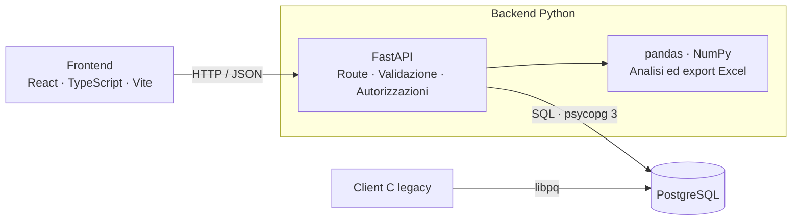
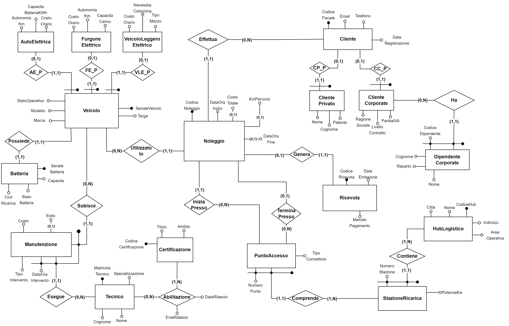

<div align="center">

# ⚡ EcoFleet Solutions

### Mobilità elettrica, gestione delle flotte e analisi dei dati.

Una piattaforma full stack per gestire veicoli elettrici condivisi,<br>
noleggi, clienti aziendali e operazioni di manutenzione.

<p>
  
  
  
  
</p>
<p>
  
  
  
  
</p>

[Cosa offre](#cosa-offre) · [Architettura](#architettura) · [Avvio locale](#avvio-locale) · [API](#api) · [Roadmap](#roadmap)

**In sviluppo** · Backend operativo · Interfaccia React in evoluzione

</div>

---

## Il progetto

**EcoFleet Solutions** esplora la gestione di un servizio di mobilità elettrica condivisa: dalla ricerca di un veicolo al termine del noleggio, dalla tariffazione individuale agli accordi corporate, fino all'analisi economica della flotta.

Il progetto nasce nell'ambito del corso di **Basi di Dati dell'Università di Padova**, con modellazione concettuale, progettazione relazionale, SQL e un client C. Su questa base si sta sviluppando un'applicazione web con **React e TypeScript**, un backend **Python/FastAPI** e strumenti di analisi con **pandas e NumPy**.

È anche un percorso pratico di apprendimento: collegare un'interfaccia a un'API, gestire dati e transazioni, costruire report e, nei prossimi passi, rendere l'ambiente riproducibile con **Docker** e sperimentare l'orchestrazione con **Kubernetes**.

## Cosa offre

| Area | Funzionalità disponibili | Interfaccia web |
| :--- | :--- | :--- |
| 🔐 Account | Registrazione privata e corporate, login JWT, profilo e controlli dei ruoli | Login e accesso alla dashboard |
| 🚗 Flotta | Lista e dettaglio veicoli, filtri per marca e stato, tariffa del singolo mezzo | Ricerca e mappa da realizzare |
| ⏱️ Noleggi | Avvio, chiusura, storico personale e controlli su credito, batteria e disponibilità | Visualizzazione dello storico |
| 💳 Wallet | Saldo virtuale, ricariche e associazione simulata di un metodo di pagamento | Pagina wallet da realizzare |
| 🏢 Corporate | Anagrafica aziendale, dipendenti associati e livelli di sconto contrattuali | Pannello dedicato da realizzare |
| 🔧 Manutenzione | Registrazione degli interventi e aggiornamento dello stato del veicolo | Backoffice da realizzare |
| 📊 Analisi | Ricavi totali e per veicolo, costo medio, deviazione standard ed esportazione Excel | Dashboard analitica da realizzare |

Il modello PostgreSQL comprende auto, furgoni, scooter e biciclette elettriche, batterie, hub logistici, stazioni e punti di accesso, clienti, tecnici, manutenzioni, noleggi e ricevute.

> Il wallet usa **crediti virtuali**. Ricariche e metodi di pagamento non sono collegati a un servizio di incasso reale. I dati sulle batterie provengono dal database; non è presente un'integrazione con dispositivi di telemetria.

## Architettura



- **Frontend:** gestisce navigazione, autenticazione lato interfaccia e visualizzazione dei dati restituiti dalle API.
- **Backend:** valida le richieste con Pydantic, verifica l'utente e i suoi permessi, esegue query parametrizzate e coordina le transazioni.
- **Database:** mantiene vincoli, relazioni e regole tramite funzioni e trigger, inclusi calcolo del costo, aggiornamento dei chilometri e generazione delle ricevute.
- **Analisi:** pandas organizza e aggrega i dati; NumPy calcola statistiche; OpenPyXL permette di produrre file `.xlsx` in memoria.

### Tecnologie

| Componente | Tecnologie | Impiego |
| :--- | :--- | :--- |
| Interfaccia | React, TypeScript, React Router, Tailwind CSS | Componenti, navigazione e stile |
| Sviluppo frontend | Vite, ESLint | Server locale, build e controllo del codice |
| API | Python, FastAPI, Pydantic, Uvicorn | Endpoint HTTP e validazione |
| Persistenza | PostgreSQL, PL/pgSQL, psycopg 3 | Query SQL, transazioni, funzioni e trigger |
| Autenticazione | PyJWT, pwdlib, bcrypt | Token di accesso e hashing delle password |
| Analisi e report | pandas, NumPy, OpenPyXL | Aggregazioni, statistiche ed Excel |
| Test backend | unittest, PostgreSQL temporaneo | Test di integrazione HTTP |
| Client originario | C, libpq | Esecuzione delle query del progetto universitario |
| Evoluzione prevista | Docker, Kubernetes | Containerizzazione e orchestrazione, ancora da introdurre |

## Tariffe e regole di noleggio

La tariffa appartiene al **singolo veicolo**: due auto della stessa categoria possono avere prezzi differenti. PostgreSQL recupera il costo orario dalla tabella del relativo sottotipo.

La formula attuale è:

```text
minuti addebitati = massimo tra 1 e i minuti iniziati
costo finale = arrotonda((1 € di sblocco + minuti × tariffa oraria / 60) × fattore contratto, 2)
```

| Contratto | Sconto sul totale, sblocco incluso |
| :--- | ---: |
| Privato / Base | 0% |
| Silver | 5% |
| Gold | 10% |
| Premium | 15% |

**Esempio:** per un'auto a 120 €/ora, un noleggio di 61 secondi conta due minuti. Con contratto Premium: `(1 + 2 × 120 / 60) × 0,85 = 4,25 €`.

L'avvio richiede almeno **5 € di credito**, una batteria almeno al **15%**, un veicolo disponibile e un punto di accesso compatibile. Un cliente e un veicolo possono avere un solo noleggio attivo.

Alla chiusura, costo, ricevuta, saldo, chilometraggio e stato del mezzo vengono aggiornati nella stessa transazione. Se il credito non basta, l'operazione viene annullata e il noleggio resta attivo fino alla ricarica. Blocchi di riga e indici unici proteggono dalle richieste simultanee e dai doppi addebiti.

## Struttura del repository

```text
.
├── backend/
│   ├── app/
│   │   ├── main.py             # FastAPI application assembly
│   │   ├── api/
│   │   │   ├── dependencies.py # Authentication dependency
│   │   │   └── routes/         # Auth, fleet, rentals, corporate, backoffice
│   │   ├── core/              # Environment settings and security
│   │   ├── db/                # PostgreSQL connection factory
│   │   ├── middleware/        # CORS registration
│   │   └── schemas/           # Pydantic request and response models
│   ├── tests/                 # HTTP integration tests
│   └── requirements.txt
├── frontend/                  # React app and npm manifests
├── legacy/c/                  # Original C client and native libraries
├── sql/
│   ├── ecofleet.sql           # Initial schema and sample data
│   └── migrations/            # Updates for existing databases
├── docs/                      # Guides, academic report and ER diagram
├── .env.example               # Local configuration template
└── README.md
```

La [guida alla struttura](docs/struttura_progetto.md) spiega il ruolo dei moduli e il percorso di una richiesta attraverso l'applicazione.

## Avvio locale

### Prerequisiti

- **Python** e le dipendenze elencate in `backend/requirements.txt`.
- **PostgreSQL** avviato, con i comandi `psql` e `createdb` disponibili.
- **Node.js 20.19+ oppure 22.12+** e npm, secondo i requisiti di Vite.
- **Git** per clonare il repository.

L'ambiente di sviluppo attualmente verificato usa **Python 3.14, PostgreSQL 18 e Node.js 24**. Gli esempi seguenti usano una shell macOS/Linux.

### 1. Clonare e preparare Python

```bash
git clone https://github.com/hipietro/ecofleet-solutions-db.git
cd ecofleet-solutions-db
python3 -m venv venv
source venv/bin/activate
python -m pip install -r backend/requirements.txt
```

Su Windows, attivare l’ambiente in PowerShell con `.\venv\Scripts\Activate.ps1`.

### 2. Configurare l'ambiente

```bash
cp .env.example .env
python -c "import secrets; print(secrets.token_hex(32))"
```

Inserire il valore generato in `JWT_SECRET_KEY` nel file `.env` e configurare la connessione PostgreSQL.

| Variabile | Valore di esempio | Significato |
| :--- | :--- | :--- |
| `DB_HOST` | `localhost` | Host PostgreSQL |
| `DB_PORT` | `5432` | Porta PostgreSQL |
| `DB_NAME` | `ecofleet` | Nome del database |
| `DB_USER` | `postgres` | Utente PostgreSQL |
| `DB_PASSWORD` | Da configurare | Password dell'utente DB, se richiesta |
| `JWT_SECRET_KEY` | Valore casuale generato | Chiave per firmare i token |

`.env` è escluso dal versionamento. Le variabili già impostate nell'ambiente hanno precedenza sui valori del file.

### 3. Inizializzare un database nuovo

I comandi assumono host `localhost` e utente `postgres`: adeguarli alla propria configurazione.

```bash
createdb -h localhost -U postgres ecofleet
psql -h localhost -U postgres -d ecofleet -v ON_ERROR_STOP=1 -f sql/ecofleet.sql
psql -h localhost -U postgres -d ecofleet -v ON_ERROR_STOP=1 -f sql/migrations/001_api_stabilization.sql
```

> [!IMPORTANT]
> `sql/ecofleet.sql` ricrea le tabelle e cancella i dati esistenti. Su un database già in uso, applicare soltanto la migrazione necessaria, senza rieseguire lo script iniziale.

I dati accademici di esempio non costituiscono un insieme di account con credenziali di accesso predefinite. Per provare il login, registrare un nuovo utente tramite le API.

### 4. Avviare il backend

Dalla root del repository, con l'ambiente virtuale attivo:

```bash
python -m uvicorn backend.app.main:app --reload --port 8000
```

### 5. Avviare il frontend

In un secondo terminale, dalla root del repository:

```bash
cd frontend
npm ci
npm run dev -- --port 5173 --strictPort
```

La porta 5173 corrisponde all'origine già consentita dalla configurazione CORS del backend.

| Servizio | Indirizzo locale |
| :--- | :--- |
| Applicazione React | [localhost:5173](http://localhost:5173) |
| API | [localhost:8000](http://localhost:8000) |
| Swagger UI | [localhost:8000/docs](http://localhost:8000/docs) |
| Specifica OpenAPI | [localhost:8000/openapi.json](http://localhost:8000/openapi.json) |
| Stato del servizio | [localhost:8000/health](http://localhost:8000/health) |

## API

Swagger UI permette di esplorare e provare gli endpoint. Il login usa un form OAuth2: il campo **`username` contiene l'email**, mentre `password` contiene la password dell'account. Gli endpoint protetti richiedono `Authorization: Bearer <token>`.

| Metodo | Percorso | Funzione | Accesso |
| :--- | :--- | :--- | :--- |
| `GET` | `/health` | Stato del servizio | Pubblico |
| `POST` | `/api/auth/register` | Registrazione privata | Pubblico |
| `POST` | `/api/auth/register/corporate` | Registrazione aziendale | Pubblico |
| `POST` | `/api/auth/login` | Login e token JWT | Pubblico |
| `GET` | `/api/auth/me` | Profilo e saldo | Autenticato |
| `POST` | `/api/auth/wallet/topup` | Ricarica virtuale | Autenticato |
| `POST` | `/api/auth/payment-method` | Associazione di un identificativo di pagamento | Autenticato |
| `GET` | `/api/fleet/vehicles` | Lista veicoli; filtri `stato` e `marca` | Pubblico |
| `GET` | `/api/fleet/vehicles/{seriale}` | Dettaglio veicolo | Pubblico |
| `POST` | `/api/rentals/start` | Avvio noleggio | Autenticato |
| `POST` | `/api/rentals/stop` | Chiusura noleggio | Autenticato |
| `GET` | `/api/rentals/me` | Storico personale | Autenticato |
| `POST` | `/api/corporate/dipendenti` | Inserimento dipendente aziendale | Corporate |
| `POST` | `/api/backoffice/maintenance` | Registrazione manutenzione | Manager o technician |
| `GET` | `/api/backoffice/analytics/kpi` | Indicatori economici | Manager |
| `GET` | `/api/backoffice/reports/export` | Download report `.xlsx` | Manager |

Esempio di ricerca:

```bash
curl "http://localhost:8000/api/fleet/vehicles?stato=Disponibile&marca=BMW"
```

Gli schemi completi delle richieste e delle risposte sono disponibili nella documentazione OpenAPI generata dall'applicazione.

## Verifiche e test

La suite backend comprende **15 test di integrazione HTTP**. Verifica autenticazione e ruoli, registrazione, tariffe, sconti corporate, storico, batteria, rollback e richieste simultanee.

Dalla root, con l'ambiente virtuale attivo:

```bash
ECOFLEET_RUN_DB_TESTS=1 python -m unittest discover -s backend/tests -v
```

La suite richiede PostgreSQL locale e un utente autorizzato a creare database. Crea un database temporaneo `ecofleet_test_...`, avvia un server API separato e li rimuove al termine. Il database indicato in `DB_NAME` non viene usato per eseguire i test.

Per il frontend, dalla directory `frontend/`:

```bash
npm run lint
npm run build
```

La [guida alla stabilizzazione](docs/stabilizzazione_backend.md) approfondisce le correzioni e il funzionamento delle verifiche.

## Modello dati e documentazione

Il modello usa entità generali e tabelle di specializzazione: per esempio `Veicolo` con `AutoElettrica`, `FurgoneElettrico` e `VeicoloLeggeroElettrico`, oppure `Cliente` con i relativi dettagli privati e corporate.

<details>
<summary><strong>📐 Visualizza il diagramma entità-relazioni</strong></summary>

<p align="center">
  
</p>

</details>

| Risorsa | Contenuto |
| :--- | :--- |
| [Relazione universitaria](docs/Relazione%20Progetto%20EcoFleet.pdf) | Modellazione e progettazione originaria del database |
| [Diagramma ER](docs/er_diagram.png) | Rappresentazione del modello concettuale originario |
| [Struttura del progetto](docs/struttura_progetto.md) | Organizzazione del codice e responsabilità dei moduli |
| [Stabilizzazione backend](docs/stabilizzazione_backend.md) | Tariffe, transazioni e test di integrazione |
| [Client C](legacy/c/README.txt) | Compilazione e utilizzo del programma originario |
| [Migrazioni SQL](sql/migrations/) | Evoluzione dello schema per l'applicazione web |

La relazione e il diagramma documentano la base accademica; le successive estensioni dell'API sono descritte nelle guide e nelle migrazioni.

## Roadmap

- [x] Modello relazionale, implementazione SQL e client C.
- [x] API per account, flotta, noleggi, wallet e operazioni corporate.
- [x] Analisi con pandas e NumPy ed esportazione Excel.
- [x] Login React, dashboard con storico e integrazione con il backend.
- [x] Test di integrazione e organizzazione del backend per responsabilità.
- [ ] Completare il percorso cliente: ricerca veicoli, avvio/chiusura noleggio e wallet dall'interfaccia.
- [ ] Realizzare il backoffice per manager e tecnici e le visualizzazioni analitiche.
- [ ] Centralizzare i percorsi del frontend e consolidare la gestione dello stato.
- [ ] Introdurre **Docker** e **Docker Compose** per avviare frontend, backend e database in modo riproducibile.
- [ ] Esplorare **Kubernetes** con manifesti di deployment, servizi e configurazione dell'applicazione.

Attività e dettagli sono raccolti nelle [issue del repository](https://github.com/hipietro/ecofleet-solutions-db/issues).

## Autori e contesto accademico

Il progetto originario è stato realizzato per il corso di **Basi di Dati dell'Università di Padova** da:

- **Pietro Leonardo Acampora** — [@hipietro](https://github.com/hipietro)
- **Luca Artinian** — [@ArtiLuca](https://github.com/ArtiLuca)

L'evoluzione full stack mantiene la progettazione del database come base per applicare e approfondire sviluppo web, programmazione Python, analisi dei dati e gestione dell'ambiente applicativo.
