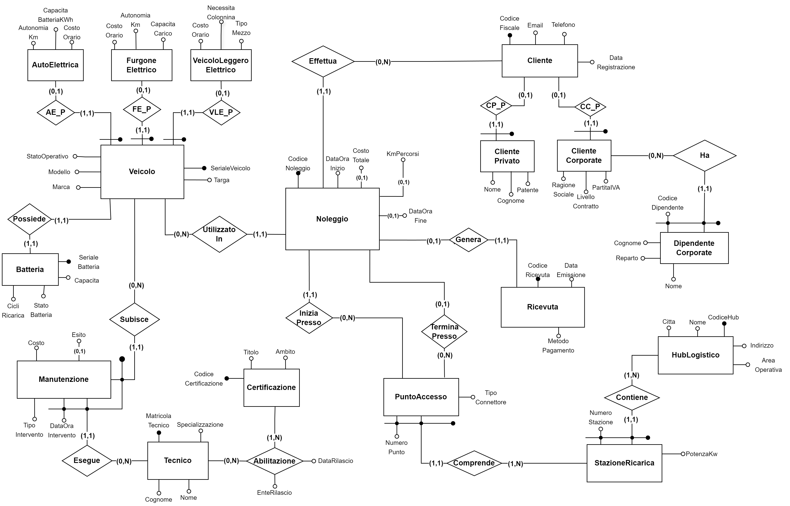

# ⚡ EcoFleet Solutions — Electric Mobility Platform

<p align="center">


</p>

---

## 📖 Overview

**EcoFleet Solutions** is a short-term electric mobility sharing platform (inspired by services like MILES / ShareNow).

Originally developed as a database design project for the **Database Systems** course at the **University of Padua**, the repository is evolving into a full-stack production-ready cloud application. It bridges robust relational modeling with a modern Python REST API, JWT authentication, virtual wallet credit system, and future deployment on **Microsoft Azure** (aligned with the **Azure AI-200** certification learning path).

The system models and manages:
- 🚗 **Electric Fleet**: Cars, vans, scooters, and e-bikes with real-time telemetry/battery tracking.
- ⚡ **Charging Infrastructure**: Logistic hubs, charging stations, and connector point compatibility.
- 👥 **Customer & Corporate Ecosystem**: Private/corporate accounts, employee sub-accounts, and contract discount tiers.
- 💳 **Virtual Wallet & Rentals**: Short-term rental lifecycle, active timer, automated cost calculation, and DB-triggered receipts.
- 🔧 **Maintenance & Backoffice**: Certified technician assignments, repair history, and AI-driven diagnostic logs.

---

## 🏗️ System Architecture & Stack

### **Backend & Domain Logic**
- **Framework**: Python 3.13 + FastAPI (RESTful API, OpenAPI/Swagger docs at `/docs`)
- **Database**: PostgreSQL 16 (Relational schema, PL/pgSQL stored procedures, triggers, custom domains)
- **Database Driver**: `psycopg` (v3) with dictionary row factory
- **Security & Auth**: Password hashing via `pwdlib` (`bcrypt`) and Stateless `JWT` tokens
- **Configuration**: Environment isolation via `.env` (transitioning to Azure Key Vault)

### **Cloud & DevOps Roadmap (Azure AI-200)**
- **Networking**: Isolated Azure VNet, Private Subnets, and Private Endpoints
- **Compute**: Containerized microservices using Docker & Azure Container Apps
- **AI Integration**: Semantic search (`pgvector`) on vehicle maintenance logs via Azure OpenAI

---

## 🛠️ Technologies

| Layer | Technology | Role |
| :--- | :--- | :--- |
| **Database** | PostgreSQL 16 / SQL | Schema design, domains, triggers, functions |
| **Backend API** | Python 3.13 / FastAPI | RESTful web services, routing, validation |
| **Security** | Bcrypt / PyJWT | Password encryption and role-based access control |
| **Legacy Client** | C / libpq | Original CLI database client |
| **Cloud (Target)** | Microsoft Azure | Infrastructure, VNet, Container Apps, Key Vault |

---

## 📂 Repository Structure

```text
.
├── docs/
│   ├── Relazione Progetto EcoFleet.pdf
│   └── er_diagram.png
├── sql/
│   └── ecofleet (1).sql       # Full database initialization script
├── src/
│   ├── database.py             # Database connection factory & env loader
│   ├── security.py             # Bcrypt hashing & JWT token generation
│   ├── main.py                 # FastAPI application entry point & routes
│   └── query_all.c             # Legacy C database application
├── .env                        # Local environment variables (gitignored)
├── requirements.txt            # Python dependencies
└── README.md
```

---

## 🚀 Quick Start (Local Development)

### 1. Prerequisites
- Python 3.13+
- PostgreSQL 16 running locally (or via Docker)

### 2. Database Setup
```bash
createdb ecofleet
psql -d ecofleet -f "sql/ecofleet (1).sql"
```

### 3. Backend Setup
```bash
# Create and activate virtual environment
python3 -m venv venv
source venv/bin/activate

# Install dependencies
pip install -r requirements.txt

# Start FastAPI development server
uvicorn src.main:app --reload --port 8000
```

Access interactive API documentation at: `http://localhost:8000/docs`

---

## 📊 Entity-Relationship Diagram

<p align="center">
  
</p>

---

## 👨‍💻 Authors & Academic Context

Developed originally for the **Database Systems** course at the **University of Padua**.

- **Pietro Leonardo Acampora** - [@hipietro](https://github.com/hipietro)
- **Luca Artinian** - [@ArtiLuca](https://github.com/ArtiLuca)