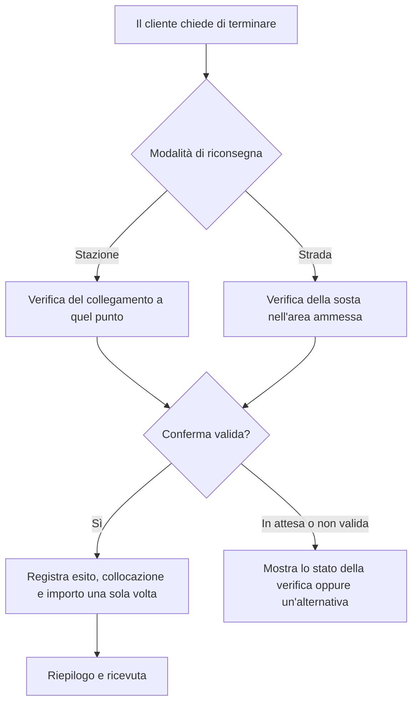

<!--
File overview
Purpose: Describe the technical design for hybrid electric-car rentals.
Responsibilities: Document the current constraints, proposed data and API contracts, validation,
  transactional updates, pricing and implementation order.
Connections: Implements the product rules described in ritiro_riconsegna_auto.md and links the affected
  PostgreSQL, FastAPI and React components to the GitHub plan.
-->

# EcoFleet: progettazione tecnica del noleggio ibrido

**Stato:** progetto da implementare. **Ambito iniziale:** auto elettriche. La [specifica di prodotto](ritiro_riconsegna_auto.md) descrive ciò che vedono il cliente e lo staff. Qui spieghiamo quali dati e controlli devono sostenere ciascuna azione.

Per ogni incremento seguiremo lo stesso ordine: **cosa deve succedere**, **come funziona oggi**, **quale parte cambiamo e perché**, **codice della sola sezione corrente**, **come verificare l’effetto**. Il codice applicativo verrà scritto per piccoli passi con commenti in inglese.

## 1. Il punto di partenza nel codice

| Componente | Comportamento attuale | Conseguenza per il nuovo flusso |
| --- | --- | --- |
| [Schema SQL iniziale](../sql/ecofleet.sql) | `Noleggio` richiede hub, stazione e punto di partenza. Una corsa completata deve avere anche tutti e tre i riferimenti di arrivo, chilometri e costo | La riconsegna in strada richiede una modifica esplicita ai vincoli, e il ritiro successivo deve poter partire da una posizione stradale |
| [Schemi noleggio FastAPI](../backend/app/schemas/rentals.py) | I modelli di avvio e chiusura richiedono gli identificativi dello slot. La chiusura richiede anche chilometri percorsi positivi | Il contratto deve distinguere i due tipi di luogo. La fonte dei chilometri resta da definire, soprattutto per una corsa senza spostamento |
| [Route del noleggio](../backend/app/api/routes/rentals.py) | L’avvio controlla cliente, saldo, veicolo e batteria. La chiusura usa il costo di PostgreSQL e aggiorna saldo e stato del mezzo nella transazione. Nessuna delle due operazioni aggiorna l’occupazione dello slot | Al ritiro e alla riconsegna dovremo coordinare anche la posizione corrente del mezzo. La politica sul credito insufficiente va decisa prima di cambiare il comportamento |
| [Migrazioni 002–004](../sql/migrations/) | Registrano ubicazione delle stazioni, assegnazione del mezzo, occupazione verificata e operatività del punto | Questi dati rimangono la base per gli slot. La posizione in strada richiede una rappresentazione propria |
| [API flotta](../backend/app/api/routes/fleet.py) | Espone stazioni e singoli punti con occupazione e stato tecnico. La lista dei mezzi filtra per stato e marca | Alla mappa serve una posizione corrente per ciascun mezzo ritirabile. Serve inoltre un criterio di compatibilità con l’auto della corsa |
| [Seed dimostrativo](../sql/seeds/001_demo_station_inventory.sql) | Crea un hub, due stazioni, uno slot occupato e uno libero per un’auto fittizia | È la base per la demo in stazione. Serviranno dati espliciti per un’area, un parcheggio in strada e riscontri simulati |
| [Frontend](../frontend/src/pages/) | Ha lista flotta, scheda veicolo, noleggi e profilo | Restano da collegare i flussi di avvio, mappa durante la corsa e conferma in una delle due modalità |

L’implementazione precedente obbligava a registrare uno slot per ogni corsa. Rendere alcuni campi opzionali nello schema Python lascerebbe comunque i vincoli PostgreSQL incompatibili con la riconsegna in strada. La progettazione parte quindi dal significato dei posti di ritiro e riconsegna e passa poi ai contratti API.

## 2. Modellare i due luoghi prima di scrivere la migrazione

### 2.1 Luogo corrente e luoghi della corsa

Il backend deve rispondere a due domande diverse:

- **Dove si trova l’auto adesso?** La risposta serve a Esplora e allo staff. È un’informazione operativa che cambia al ritiro, alla riconsegna e agli eventuali spostamenti di servizio.
- **Dove è iniziata e terminata quella corsa?** La risposta serve allo storico. È un’informazione relativa a un evento passato e rimane consultabile dopo uno spostamento del mezzo.

Esempio: l’auto 144 termina la prima corsa alla stazione Nord, viene ritirata dal cliente successivo e termina la seconda corsa in strada. La posizione corrente è in strada. La prima ricevuta mostra ancora Nord e il bonus di quella corsa.

### 2.2 I tipi di luogo

| Campo concettuale | Stazione | Strada |
| --- | --- | --- |
| Tipo | `stazione` | `strada` |
| Riferimento a uno slot | Chiave completa `codicehub`, `numerostazione`, `numeropunto` | Assente |
| Coordinate | Possiamo usare quelle della stazione per la mappa quando non conosciamo la posizione precisa dello slot | Posizione confermata dell’auto al momento della sosta |
| Area di riconsegna | Determinata dal servizio della stazione quando pertinente | Riferimento all’area verificata durante la chiusura |
| Fonte e orario | Dati della stazione più riscontro del punto alla riconsegna | Fonte della posizione del mezzo, ora e precisione disponibili |
| Bonus di riconsegna | Ammesso dopo riscontro valido e secondo le condizioni del noleggio | 0% |

I nomi sono indicativi. Il contratto dovrà richiedere le informazioni che appartengono al tipo scelto. Per esempio, una restituzione in strada non può apparire in storico come se fosse avvenuta a un punto di ricarica solo perché la stazione più vicina è nota.

### 2.3 Vincoli e migrazione

1. Per la partenza in stazione, mantenere una chiave composta valida. Per la partenza in strada, registrare il luogo di ritiro verificato, con i dati di sosta necessari allo storico.
2. Una corsa attiva ha un luogo di partenza. Una corsa completata ha anche un arrivo valido e i dati necessari al riepilogo. Definire vincoli che distinguano chiavi incomplete, modalità sconosciute e dati di arrivo erroneamente compilati prima della chiusura.
3. Conservare la relazione attuale tra slot e veicolo e la sua unicità. Progettare un’unica fonte per la posizione corrente. Qualunque rappresentazione fisica si scelga, un veicolo parcheggiato deve avere una sola collocazione corrente, in uno slot oppure in strada.
4. Rappresentare come sconosciuta la collocazione dei mezzi preesistenti quando manca una fonte affidabile. Un mezzo con stato operativo `Disponibile` ma con collocazione ignota richiede inizializzazione prima di comparire come mezzo ritirabile. Il GPS live di un mezzo in viaggio non è una posizione di ritiro.
5. Classificare le corse storiche con riferimenti esistenti come corse da o verso stazione. Gli importi e le ricevute storiche si conservano. Usare una nuova migrazione dopo la 004 e aggiornare le istruzioni di avvio.
6. Controllare funzione di compatibilità, trigger di chiusura, vincoli e query del legacy C che assumono la presenza di uno slot. Definire il comportamento per l’archivio storico e per i chiamanti esistenti prima di cambiare i contratti.

Aggiungere il tipo di luogo rende esplicita la differenza tra **in strada**, **in stazione** e **posizione da verificare**. Per una corsa in corso l’assenza di un luogo di riconsegna indica invece che la fine non è ancora stata registrata.

## 3. Stabilire chi può confermare una riconsegna

### 3.1 Stazione: riscontro del punto per quell’auto

La mappa può suggerire una stazione e mostrare i punti disponibili. La conferma finale viene dalla fonte che osserva il collegamento. Il modello deve poter legare il riscontro a **veicolo, punto e tentativo del suo noleggio**. La correlazione può essere fatta dal backend se il dispositivo fornisce solo l’identità del mezzo, dello slot e il proprio evento.

Il caso positivo ha tre passaggi:

1. Il cliente richiede la riconsegna presso un punto.
2. Il backend riceve o recupera un riscontro recente e coerente che indica che proprio quell’auto è collegata al punto. Verifica compatibilità e stato delle informazioni.
3. La chiusura registra il veicolo al punto e applica le condizioni economiche. L’eventuale ripetizione dello stesso riscontro permette di ritrovare l’esito.

Ogni slot ospita un solo mezzo. La simulazione deve esprimere lo stesso vincolo. Il sistema deve gestire un doppio tap, una risposta persa, un evento di collegamento ripetuto e un evento per un altro mezzo. Questo è il motivo per mantenere transazione, unicità e riconciliazione, indipendentemente dal tipo di blocco SQL scelto in implementazione.

**Occupato** e **operativo** descrivono il punto. **Collegato** descrive un riscontro relativo al mezzo. **In carica** descrive un altro stato. Un’auto già carica può essere correttamente collegata prima che ci sia una misura utile dell’energia erogata. Va ancora stabilita la politica quando il collegamento riesce ma il punto segnala un guasto nella ricarica.

### 3.2 Strada: posizione del mezzo e condizioni di sosta

Per la prima versione propongo di verificare insieme:

- coordinate recenti dell’auto ottenute dalla fonte del veicolo;
- precisione sufficiente per decidere se la sosta rientra in un’area attiva e fuori dalle esclusioni;
- auto ferma e chiusa, in base a segnali verificabili o al simulatore della demo;
- conferma della persona di aver lasciato l’auto in un posto dove la sosta è ammessa.

Il GPS del telefono serve anche quando la persona si è già allontanata. Per questo resta una fonte distinta dal GPS dell’auto. La precisione e l’età ammesse del dato rientrano nella progettazione dell’area e della fonte. Se non si può verificare il posto, servono messaggi distinti per segnale mancante, segnale vecchio, punto sul confine e zona esclusa.

Il sistema deve conservare la posizione di **sosta** per rendere possibile il ritiro successivo. Per mezzi con poca carica o altre limitazioni, distinguere «posizione nota» da «disponibile da ritirare». Lo staff può vedere i casi che richiedono recupero.

### 3.3 Simulazione locale e flusso di produzione

| Sorgente | Demo | Produzione |
| --- | --- | --- |
| Collegamento in stazione | Il simulatore del backend emette riscontri dichiaratamente fittizi per mezzo e slot | Il backend riceve riscontri dall’infrastruttura o dal fornitore scelto, con autenticazione della sorgente |
| Posizione e stato dell’auto | Fixture o simulazione che produce posizione, precisione, movimento e stato di chiusura | Telemetria del veicolo e riscontro sullo stato richiesto |
| Posizione del telefono | Permesso del browser oppure coordinate chiaramente marcate come dimostrative | Geolocalizzazione fornita dal telefono per l’utente |
| Area di sosta | Una o più zone fittizie con un punto interno e uno esterno | Aree e regole operative configurate e mantenute dal servizio |

Il client invia l’intenzione di terminare e la modalità scelta. La conferma proviene dal backend e dalla sorgente appropriata. Il backend di produzione deve avere la propria configurazione esplicita per le sorgenti reali. Il flusso dei dati fittizi viene riservato agli ambienti di sviluppo.

## 4. Disegnare il contratto API e la schermata insieme

Per discutere la forma del dato, questi sono **esempi di richiesta futura**, non payload utilizzabili con l’endpoint attuale. I nomi e l’eventuale endpoint per consultare un tentativo verranno scelti insieme.

```json
{
  "codicenoleggio": 123,
  "modalita": "stazione",
  "punto": { "codicehub": 6, "numerostazione": 2, "numeropunto": 1 }
}
```

```json
{
  "codicenoleggio": 123,
  "modalita": "strada",
  "sosta_confermata": true
}
```

Nel secondo esempio `sosta_confermata` rappresenta una dichiarazione del cliente. Il server recupera la posizione dell’auto e gli altri segnali. Nella modalità stazione, la richiesta indica il punto scelto. Stabiliremo come esprimere a parte la prova di connessione ricevuta dal dispositivo.

| Esito | Risposta da progettare | Cosa mostra React |
| --- | --- | --- |
| Verifica in corso | Tentativo identificabile, se il riscontro arriva in modo asincrono | Stato di attesa e possibilità di recuperare l’esito dopo un ricaricamento |
| Chiusura confermata | Esito con luogo, modalità, importo, bonus ed eventuale saldo da regolare secondo la politica concordata | Riepilogo e accesso alla ricevuta |
| Verifica fallita | Motivo distinguibile: area, punto, compatibilità, posizione indisponibile oppure riscontro incoerente | Indicazione concreta e alternative disponibili |
| Richiesta o evento già elaborati | Esito già registrato oppure meccanismo documentato per consultarlo | Il cliente ritrova il riepilogo senza un altro addebito |

**Perché separare i ruoli:** Pydantic valida la forma dell’input, per esempio che un punto abbia tre campi interi. Le regole del backend verificano i dati effettivi, per esempio se quel punto è compatibile. PostgreSQL conserva il risultato e garantisce i vincoli tra righe. React rappresenta la risposta e permette di agire; l’interfaccia non decide autonomamente che il veicolo è stato agganciato o che lo sconto è dovuto.

## 5. Applicare la chiusura e il prezzo una volta sola



Una volta ricevuta una conferma idonea, progettare la transazione che registra la fine corsa, la collocazione, l’occupazione quando c’è uno slot, il costo, saldo e ricevuta. Le chiamate esterne e l’attesa dei dispositivi si gestiscono prima di eseguire la transazione finale. Il backend rivalida, al momento della scrittura, le informazioni che possono cambiare. In caso di esito incerto deve poter recuperare il risultato senza riaddebitare il cliente.

Per il prezzo, il sistema attuale usa la funzione PostgreSQL installata dalla [migrazione 001](../sql/migrations/001_api_stabilization.sql). La funzione calcola il costo alla chiusura sulla base della tariffa del singolo mezzo, dei minuti e del corporate. La versione futura deve continuare a produrre un totale autorevole per ricevuta e addebito e indicare le sue componenti.

La **regola di lavoro per il bonus** è: stessa base della corsa e stesso corporate, poi fattore **0,90** per la stazione confermata e **1,00** per la strada. Proponiamo arrotondamento ai centesimi sul totale finale, con rappresentazione decimale nelle API. Se vengono mostrati anche subtotali e importo del bonus, stabilire come arrotondarli affinché la ricevuta torni al centesimo. Registrare tariffa e promozione applicate rende la ricevuta indipendente da modifiche future del listino. Il calcolo degli intervalli di pausa al 50% resta nella [#24](https://github.com/hipietro/ecofleet-solutions-db/issues/24).

La decisione sul **saldo insufficiente dopo una restituzione fisica valida** rimane aperta. Oggi il rifiuto economico annulla la chiusura. La proposta è distinguere il momento in cui il cliente ha effettivamente restituito il mezzo da quello in cui salda il credito. Prima di attivare il nuovo flusso occorre fissare quando si ferma il tempo, come trattare l’importo scoperto e quali nuove corse permettere.

## 6. Ordine di implementazione per piccoli passi

| Passo | Obiettivo | Oggi | Modifica da progettare e verificare |
| --- | --- | --- | --- |
| 1. Luoghi | Ritiro e riconsegna funzionano in entrambi i tipi di luogo | Le tre chiavi dello slot sono obbligatorie | Contratto dei luoghi e migrazione con storico preservato, verificati su un database isolato |
| 2. Dati locali | Rendere provabili i due percorsi | C’è già un veicolo DEMO in stazione | Preparare area fittizia, parcheggio e riscontri simulati per stazione e strada |
| 3. Fine corsa | Accettare una restituzione verificata e conservarne l’esito | La chiusura usa solo i riferimenti allo slot | Definire prova di connessione, prova di sosta, riconciliazione e transazione finale |
| 4. Prezzo e storico | Mostrare bonus, corporate e totale coerenti | Le ricevute usano la tariffazione attuale | Progettare importi registrati, arrotondamenti e breakdown. Verificare stazione contro strada a parità di corsa |
| 5. Ritiro successivo | Ritrovare e prendere l’auto dove è parcheggiata | La lista dei mezzi non espone il luogo di ritiro effettivo | Leggere una posizione corrente verificata e completare l’avvio da entrambi i luoghi |
| 6. Schermate | Scegliere, confermare e recuperare l’esito | Manca il percorso React per il noleggio | Esplora, mappa della corsa, restituzione, riepilogo e accesso dal Profilo |

Per la demo, i passi 2–5 possono essere provati con dati dichiaratamente fittizi. Per il percorso di produzione l’integrazione con il veicolo e la colonnina ha criteri propri. L’uso di un simulatore serve a provare il percorso senza dipendere dai dispositivi mentre lo stiamo sviluppando.

La prima verifica completa deve seguire un’auto dalla stazione alla strada e da lì al ritiro successivo. Poi si prova una riconsegna in stazione con bonus. Ripetere una conferma dopo una risposta persa deve lasciare un solo addebito. Provare inoltre una posizione fuori area, un connettore incompatibile, un evento riferito a un altro mezzo, GPS vecchio e credito insufficiente secondo la politica scelta. La [specifica di prodotto](ritiro_riconsegna_auto.md#9-come-capire-se-il-percorso-funziona) raccoglie i risultati attesi da chi usa l’app.

## 7. Come seguire il lavoro su GitHub

| Area | Issue |
| --- | --- |
| Modello condiviso dei luoghi e posizione corrente | [#23](https://github.com/hipietro/ecofleet-solutions-db/issues/23) |
| Operazioni e verifiche della sosta in strada | [#35](https://github.com/hipietro/ecofleet-solutions-db/issues/35) |
| Conferma del collegamento in stazione | [#36](https://github.com/hipietro/ecofleet-solutions-db/issues/36) |
| Bonus e componenti del totale | [#37](https://github.com/hipietro/ecofleet-solutions-db/issues/37) |
| Posizioni GPS reali durante la corsa e convalida della sosta | [#25](https://github.com/hipietro/ecofleet-solutions-db/issues/25) |
| Mappa, scelta della riconsegna e riepilogo nella web app | [#19](https://github.com/hipietro/ecofleet-solutions-db/issues/19), [#27](https://github.com/hipietro/ecofleet-solutions-db/issues/27), [#28](https://github.com/hipietro/ecofleet-solutions-db/issues/28) |
| Ricevuta nel Profilo e verifica dello storico | [#29](https://github.com/hipietro/ecofleet-solutions-db/issues/29), [#21](https://github.com/hipietro/ecofleet-solutions-db/issues/21) |

Il [backlog cliente](https://github.com/hipietro/ecofleet-solutions-db/issues/6) è l’indice per seguire le dipendenze. Le milestone coprono [backend e demo](https://github.com/hipietro/ecofleet-solutions-db/milestone/4) e [percorso cliente nella web app](https://github.com/hipietro/ecofleet-solutions-db/milestone/5). Il completamento del percorso dimostrativo e la disponibilità in produzione sono due traguardi distinti.
